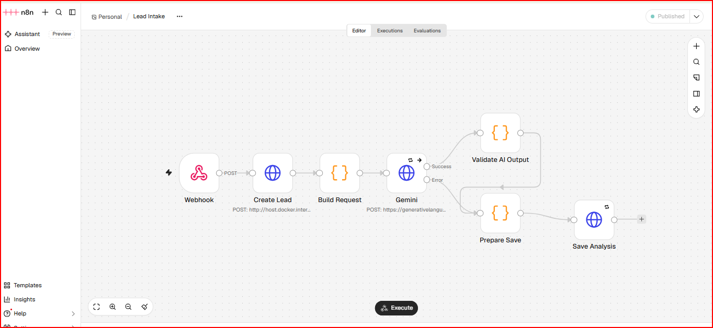
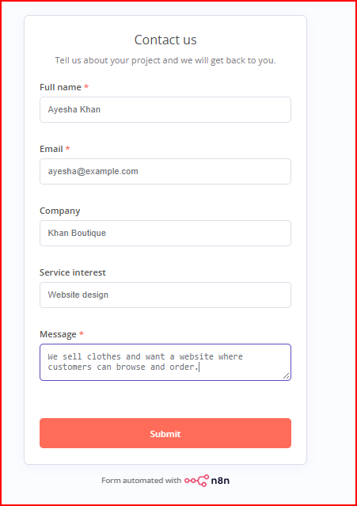
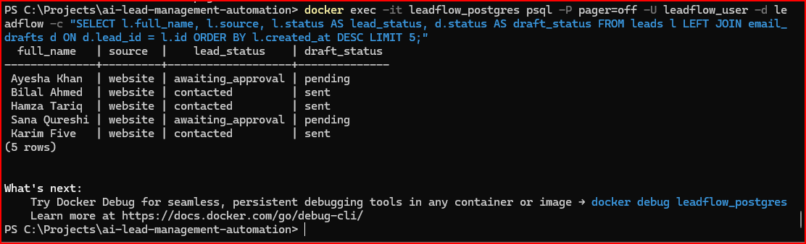

# AI-Powered Lead Management & Follow-Up Automation System

An automation system that captures customer leads from a website form, stores them in a database, analyzes them with AI, writes a personalized follow-up email, and only sends it after a human approves it.

**Status:** Core pipeline working end to end (form, intake, AI analysis, draft, approval, email). A React dashboard for approvals is planned; for now approvals go through the API.

## What it does

1. A visitor fills in a public **contact form** (built with n8n).
2. The **Lead Intake** workflow sends the lead to the backend, which validates it, detects duplicates and saves it in PostgreSQL.
3. **Google Gemini** analyzes the lead (category, priority) and drafts a reply email. The AI output is validated before it is saved, and failures are handled without losing the lead.
4. The draft waits with the status `pending`. A human **approves or rejects** it through the API.
5. The **Send Approved Emails** workflow picks up approved drafts and sends them. The lead then moves to `contacted` and the draft to `sent`.

Every status change is recorded in a history table.

## Screenshots

### Public contact form


### Lead Intake workflow (n8n)


### Approved emails delivered (Mailpit test inbox)


### Leads and draft statuses in PostgreSQL


## Architecture

```
Contact form (n8n)
      |
      v
Website Form workflow --> Lead Intake workflow (n8n webhook)
                                   |
                                   v
                          FastAPI backend --> PostgreSQL
                                   |
                                   v
                         Gemini AI analysis + email draft
                                   |
                                   v
                    Draft saved as "pending" (awaiting approval)
                                   |
                       Human approves via API
                                   |
                                   v
              Send Approved Emails workflow (n8n) --> Email sent
```

## Tech stack

- **n8n**: workflow automation (form, intake, AI step, email sending)
- **Python + FastAPI**: backend API with validation and API key protection
- **PostgreSQL 16**: leads, AI analyses, email drafts and status history
- **Alembic**: database migrations
- **Google Gemini API** (free tier): lead analysis and email drafting
- **Docker Compose**: PostgreSQL, n8n and Mailpit
- **Mailpit**: local test inbox, so no real emails are sent during development
- **pytest**: automated backend tests

## Security and reliability

- The webhook and the backend both require secret keys (`x-api-key`), compared in constant time.
- Secrets live in a `.env` file that is excluded from Git; exported n8n workflows contain only credential names, never values.
- Duplicate leads are rejected with a clear error.
- Human approval is required before any email is sent, and a draft can only be reviewed once.
- If the AI call fails, the lead is still saved and the failure is recorded.

## API overview

| Method | Endpoint | Purpose |
| --- | --- | --- |
| POST | `/leads` | Create a lead (validation and duplicate detection) |
| POST | `/leads/{id}/analysis` | Save the AI analysis and draft |
| GET | `/drafts/approved` | List approved drafts waiting to be sent |
| POST | `/drafts/{id}/review` | Approve or reject a draft |
| POST | `/drafts/{id}/sent` | Mark a draft as sent |

All endpoints under `/drafts` require the `x-api-key` header.

## Getting started

These steps assume Docker Desktop, Python 3.11 and Git are installed.

1. **Clone the repository**
   ```bash
   git clone https://github.com/mueenaliujan786-spec/ai-lead-management-automation.git
   cd ai-lead-management-automation
   ```
2. **Create your `.env` file** from `.env.example` and fill in your own values. `WEBHOOK_API_KEY` must be at least 32 characters.
3. **Start PostgreSQL, n8n and Mailpit**
   ```bash
   docker compose up -d
   ```
4. **Set up and start the backend** (from the `backend` folder, with a virtual environment active)
   ```bash
   pip install -r requirements.txt
   alembic upgrade head
   uvicorn app.main:app --port 8000
   ```
5. **Import the workflows** from the `n8n-workflows` folder into n8n (`http://localhost:5678`), create the credentials they reference (a webhook secret, the backend API key and a Gemini API key), then publish them.
6. **Open the form** from the Contact Form node's Production URL, submit a test lead, and check Mailpit at `http://localhost:8025` after approving the draft.

## Documentation

- [MVP scope](docs/mvp.md)
- [Architecture](docs/architecture.md)
- [Database design](docs/database.md)

## Roadmap

- [x] Phase 1: Requirements and planning
- [x] Phase 2: Environment setup
- [x] Phase 3: Backend development
- [x] Phase 4: n8n workflows
- [x] Phase 5: Email and approval system
- [ ] Phase 6: Frontend dashboard (React + Tailwind)
- [ ] Phase 7: Extended testing and security review
- [ ] Phase 8: Deployment
- [ ] Phase 9: Portfolio preparation
