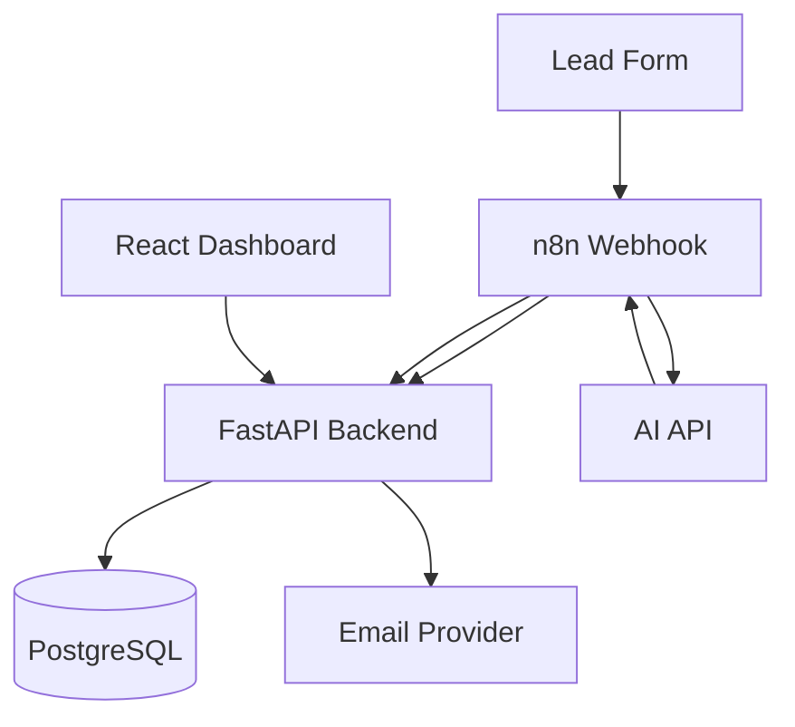

# System Architecture

## Components

| Component | Technology | Responsibility |
|---|---|---|
| Lead form | HTML form / API client | Sends new leads |
| Workflow engine | n8n | Orchestrates steps, calls AI, schedules jobs |
| Backend API | Python + FastAPI | Validation, authentication, business rules, database access |
| Database | PostgreSQL | Stores leads, AI results, drafts, logs |
| AI provider | Hosted AI API (configurable) | Analyzes the lead and writes a draft email |
| Dashboard | React + Tailwind CSS | Human review and approval |
| Email provider | SMTP / email API | Sends approved emails |

## Architecture diagram

## Lead flow (step by step)

1. A customer submits the lead form.
2. n8n receives it through a webhook.
3. n8n sends the lead to the backend.
4. The backend validates it, checks for duplicates, and saves it.
5. n8n sends the lead message to the AI.
6. The AI returns JSON analysis.
7. n8n sends the analysis to the backend, which validates and saves it.
8. A human opens the dashboard and approves, edits, or rejects the draft.
9. After approval, the backend sends the email through the provider.
10. Every step is recorded in the execution logs.

## Design rules

- Business logic and security live in the backend, not in n8n.
- Secrets (API keys, passwords) live in environment variables only.
- The dashboard never talks to the database or the AI directly.
- Retries always have a maximum limit.
- No email is sent without human approval.